# PaperBlog — Blog Management Application

A full-stack, newspaper-themed blog platform built for the **Road to SDET** assignment. It pairs a **Next.js (App Router)** frontend with a JWT-secured **Express / Sequelize / MySQL** REST API, and supports three roles: **guest**, **user** and **admin**.

All application data comes from the REST API — there are no mock blogs, hardcoded users, static lists or direct database access. Authentication is backed by real JWTs issued by the backend.

---

## Table of contents

1. [Project overview](#project-overview)
2. [Main features](#main-features)
3. [Technologies](#technologies)
4. [Repository layout](#repository-layout)
5. [Installation](#installation)
6. [Environment variables](#environment-variables)
7. [Running the application](#running-the-application)
8. [Backend dependency](#backend-dependency)
9. [Application routes](#application-routes)
10. [API reference](#api-reference)
11. [User & admin functionality](#user--admin-functionality)
12. [Screenshots](#screenshots)

---

## Project overview

PaperBlog has two parts that run side by side:

```text
Blog Management Application with Next.js/
├── backend/     # Express + Sequelize + MySQL REST API  (runs on :5000)
└── frontend/    # Next.js (App Router) + Tailwind CSS UI (runs on :3000)
```

The interface is built around two layouts:

| Layout | Used by | Contains |
| --- | --- | --- |
| **Public** | Guests and logged-in visitors | Fixed navbar · main content · footer |
| **Dashboard** | Authenticated users / admins | Fixed navbar · responsive sidebar · main content |

Guests can discover and read blogs. Registered users manage their profile, avatar, password and their own blogs. Admins additionally manage every user and moderate any blog.

PaperBlog uses a light **newspaper** look: a warm newsprint canvas, a masthead-red brand colour, serif headlines, and colour-coded category tags that read like newspaper section labels.

## Main features

- **Guest:** browse / search / filter blogs, read full posts, register, log in.
- **User:** persistent JWT session, protected dashboard, blog CRUD (own posts), profile editing, avatar upload, change password, forgot/reset password.
- **Admin:** everything a user can do, plus manage all users (view, activate/deactivate) and moderate any blog.
- **UX throughout:** loading spinners and skeletons, pending/disabled buttons (no double submits), friendly backend-driven error messages, confirmation dialogs for destructive actions, toast notifications and empty states.

See [User & admin functionality](#user--admin-functionality) for the full breakdown.

## Technologies

| Purpose | Technology |
| --- | --- |
| Frontend framework | Next.js (App Router) |
| UI library | React 19 |
| Styling | Tailwind CSS v4 |
| Fonts | `next/font` — Plus Jakarta Sans (UI) + Lora (article body) |
| Frontend state | React Context (`AuthProvider`, `NotificationProvider`) |
| HTTP | Native `fetch` via a shared API client |
| Backend runtime | Node.js (ES modules) |
| Backend framework | Express 5 |
| ORM / Database | Sequelize 6 + MySQL (`mysql2` driver) |
| Auth | JSON Web Tokens (`jsonwebtoken`) |
| Password hashing | `bcryptjs` |
| Email (password reset) | Gmail + Nodemailer |

## Repository layout

Each folder is a standalone project with its own `package.json` and `.env.example`.

```text
backend/
├── config/        # Sequelize connection
├── controllers/   # auth, user, blog
├── middlewares/   # authenticate (JWT), authorize (role guard), errorHandler, upload
├── models/        # user, blog, associations
├── routes/        # auth, user, blog
├── utils/         # ApiError, asyncHandler, response, token
├── validators/
├── database/      # schema.sql
├── app.js         # express app + route mounting
└── server.js      # boot + DB connection

frontend/
└── src/
    ├── app/         # App Router: (public), (auth), dashboard, admin
    ├── components/  # layout, blog, user, route (Protected), ui
    ├── providers/   # AuthProvider, NotificationProvider
    ├── hooks/       # useBlogs
    └── lib/         # apiClient, session, format, validators, api/ (one module per resource)
```

## Installation

**Prerequisites:** Node.js 18+ (tested on Node 22) and MySQL 8.x running locally.

Install dependencies for each project:

```bash
cd backend  && npm install
cd ../frontend && npm install
```

## Environment variables

### Backend — copy `.env.example` to `.env`

| Variable | Description | Example |
| --- | --- | --- |
| `PORT` | HTTP port | `5000` |
| `DB_HOST` | MySQL host | `localhost` |
| `DB_PORT` | MySQL port | `3306` |
| `DB_USER` | MySQL user | `root` |
| `DB_PASSWORD` | MySQL password | `secret` |
| `DB_NAME` | Database name | `blogdb` |
| `JWT_SECRET` | Secret used to sign tokens | a long random string |
| `JWT_EXPIRES_IN` | Token lifetime | `1d` |
| `GMAIL_USER` | Gmail address for reset emails (optional) | `you@gmail.com` |
| `GMAIL_APP_PASSWORD` | Gmail **App Password**, not your login password (optional) | — |

### Frontend — copy `.env.example` to `.env.local`

| Variable | Description | Example |
| --- | --- | --- |
| `NEXT_PUBLIC_API_URL` | REST API base URL — **must** end with `/api` | `http://localhost:5000/api` |
| `NEXT_PUBLIC_UPLOADS_URL` | Origin serving uploaded avatars (API origin without `/api`). Optional — derived from the API URL when blank. | `http://localhost:5000` |

> Real `.env` / `.env.local` files are git-ignored. Only the `.env.example` files are committed.

## Running the application

Open two terminals. **Start the backend first** so the UI has an API to talk to.

**1 — Backend (API):**

```bash
cd backend
cp .env.example .env     # Windows: copy .env.example .env
#   edit .env with your MySQL credentials + a JWT secret
npm run dev              # development, auto-reload via nodemon → http://localhost:5000
npm start                # production
```

The API creates its tables automatically on first boot (or you can run `database/schema.sql`). Make yourself an admin after registering:

```sql
UPDATE users SET role = 'admin' WHERE email = 'you@example.com';
```

**2 — Frontend (UI):**

```bash
cd frontend
cp .env.example .env.local   # Windows: copy .env.example .env.local
npm run dev                  # http://localhost:3000
npm run build                # production build
npm start                    # run the production build
```

Open <http://localhost:3000>.

## Backend dependency

The frontend talks to the **Blog Management REST API** (Express + Sequelize + MySQL) in the sibling `backend/` folder, which must be running on `http://localhost:5000` before you use the app. Guests who open a protected route are redirected to `/login`, and a non-admin who opens an admin route sees an **Access Denied** screen; these rules are enforced in the UI **and** by the backend, whose `401`/`403` responses the UI always respects.

### Password reset

`POST /api/auth/forgot-password` stores only a SHA-256 hash of a random token with a 15-minute expiry and always replies with the same generic message (so it never reveals which emails are registered). When Gmail credentials are configured, the reset link is emailed via Nodemailer. When mail isn't configured and the API runs in development, the response instead returns the raw reset link and the Forgot-Password page surfaces an **"Open reset link →"** shortcut, so the full flow stays testable locally without a mail server. Use a Google **App Password** (Account → Security → 2-Step Verification → App passwords), not your normal password.

## Application routes

| Route | Access |
| --- | --- |
| `/` | Public (blog explorer) |
| `/blogs/[id]` | Public (blog details) |
| `/login`, `/register` | Public |
| `/forgot-password`, `/reset-password/[token]` | Public |
| `/dashboard` | User / Admin (overview) |
| `/dashboard/blogs` | User / Admin |
| `/dashboard/blogs/create` | User / Admin |
| `/dashboard/blogs/[id]/edit` | Owner / Admin (any) |
| `/dashboard/profile` | User / Admin |
| `/dashboard/change-password` | User / Admin |
| `/admin/users` | Admin only |

## API reference

Base path: `http://localhost:5000`. Every response follows the same envelope: `{ "success": true, "message": "…", "data": { } }`. Protected endpoints expect `Authorization: Bearer <token>`.

### Auth

| Method | Endpoint | Access | Purpose |
| --- | --- | --- | --- |
| POST | `/api/auth/register` | Public | Register a new user |
| POST | `/api/auth/login` | Public | Log in and receive a JWT |
| POST | `/api/auth/forgot-password` | Public | Start a password reset (issues a one-time token) |
| PATCH | `/api/auth/reset-password/:token` | Public | Set a new password using a reset token |

### Users

| Method | Endpoint | Access | Purpose |
| --- | --- | --- | --- |
| GET | `/api/users` | Admin | List all users |
| GET | `/api/users/:id` | Admin | Get a single user |
| PATCH | `/api/users/:id/status` | Admin | Activate / deactivate a user |
| GET | `/api/users/profile` | User / Admin | Get own profile |
| PUT | `/api/users/profile/update` | User / Admin | Update own first/last name |
| PATCH | `/api/users/profile/image` | User / Admin | Upload own avatar (`multipart/form-data`, field `image`) |
| PATCH | `/api/users/password` | User / Admin | Change own password |

### Blogs

| Method | Endpoint | Access | Purpose |
| --- | --- | --- | --- |
| POST | `/api/blogs/create` | User / Admin | Create a blog |
| GET | `/api/blogs` | Public | List / search / filter blogs |
| GET | `/api/blogs/:id` | Public | Get a single blog |
| PUT | `/api/blogs/update/:id` | Owner / Admin | Update a blog |
| DELETE | `/api/blogs/delete/:id` | Owner / Admin | Delete a blog |

**Search & filter** (public, combinable): `?title=` does a partial, case-insensitive match on the title; `?category=` is an exact match — e.g. `GET /api/blogs?title=playwright&category=Testing`.

**Avatar upload:** a single `image` field (JPG / PNG / WEBP, ≤ 2 MB) via `multipart/form-data`. Files are stored under `/uploads/profile` and served statically from `/uploads`.

### Status codes

| Code | When |
| --- | --- |
| `200` / `201` | Success / created |
| `400` | Missing/invalid fields, bad email, short password, invalid id |
| `401` | Missing or invalid token / wrong credentials |
| `403` | Deactivated account, or acting outside your role/ownership |
| `404` | User or blog does not exist |
| `409` | Email already registered |
| `500` | Unexpected failure |

### Postman

- Collection: [`backend/Blog Management API.postman_collection.json`](backend/Blog%20Management%20API.postman_collection.json)
- Environment: [`backend/Blog Management API.postman_environment.json`](backend/Blog%20Management%20API.postman_environment.json)

Import both files, select the environment, and make sure `baseUrl` points to your server. The login requests include a test script that stores the returned token into `userToken` / `adminToken`, so protected requests work without copy-pasting tokens.

## User & admin functionality

### Guest
- Browse a responsive grid of blog cards (`GET /api/blogs`)
- Live, debounced search by title and filter by category (combinable)
- Read full blog details with author, avatar and date
- A clear **Blog Not Found** screen for missing posts
- Register and log in

### User
- Persistent JWT session via React Context + `localStorage` (survives refresh)
- Protected dashboard with overview stats and recent blogs
- Create, edit and delete **their own** blogs
- Update first/last name
- Upload a JPG/PNG/WEBP avatar (≤ 2 MB) — the navbar avatar updates instantly
- Change password; forgot-password → email reset-link → reset-password flow
- Logout (clears the session and blocks protected pages)

### Admin
- Everything a user can do, plus:
- View **all** blogs and edit/delete any of them
- View all users, inspect a single user, and activate/deactivate accounts
- Admin-only routes that non-admins cannot reach

### Security rules enforced on the server
- Passwords are hashed with bcrypt before storage and excluded from every query, so they never leak through a response.
- A client can never set its own `role` or `isActive` (not at registration, not on profile update).
- A blog's `userId` always comes from the token, never the request body; normal users can only modify their own blogs, admins can modify any.

## Screenshots

Screenshots of the major pages live in [`docs/`](docs/).

### Public

| Page | Screenshot |
| --- | --- |
| Home | 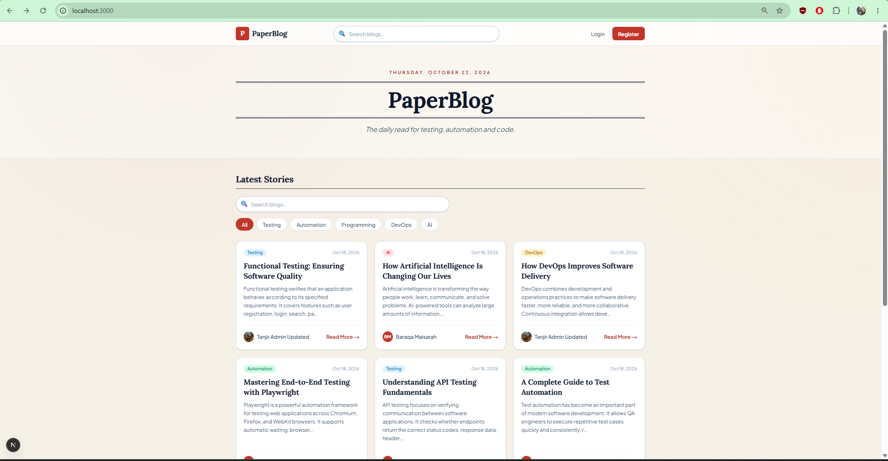 |
| Login | 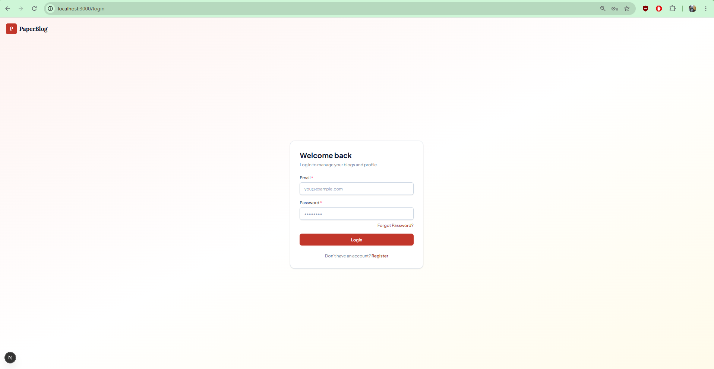 |

### Regular user

| Page | Screenshot |
| --- | --- |
| Dashboard | 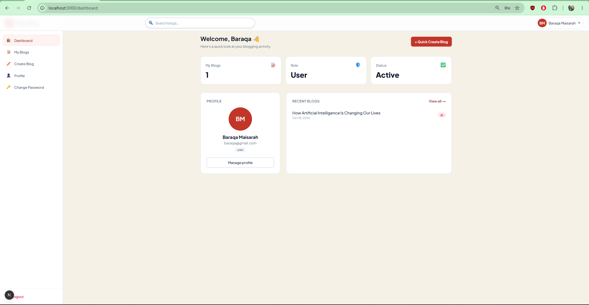 |
| Blog management | 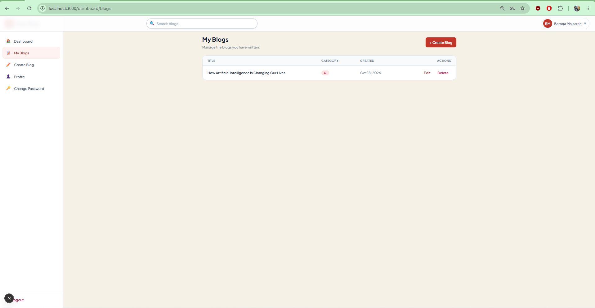 |
| Create blog | 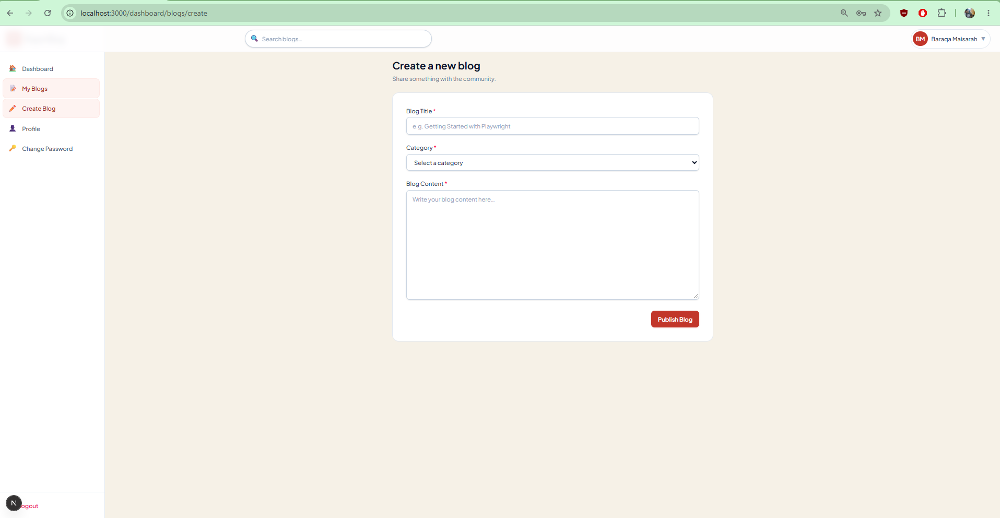 |
| Update blog | 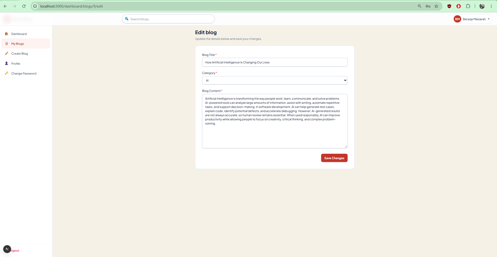 |
| Delete blog confirmation | 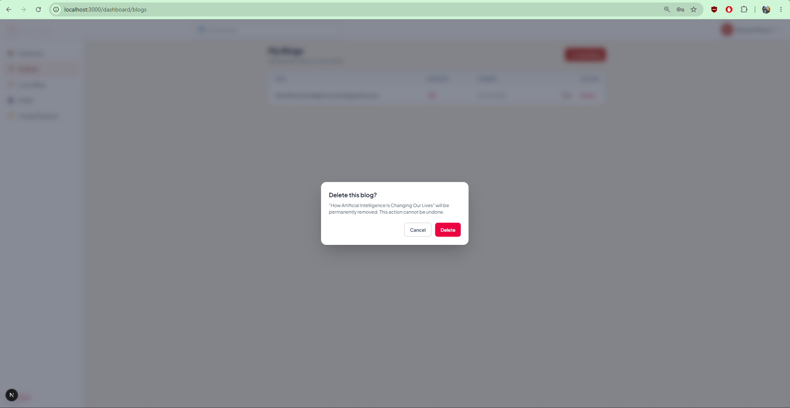 |
| Profile | 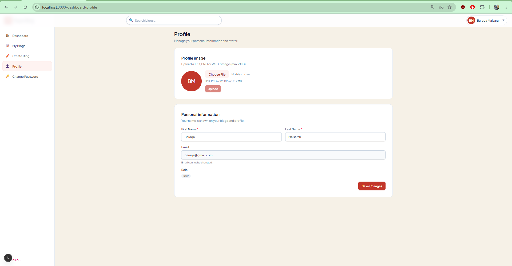 |
| Change password | 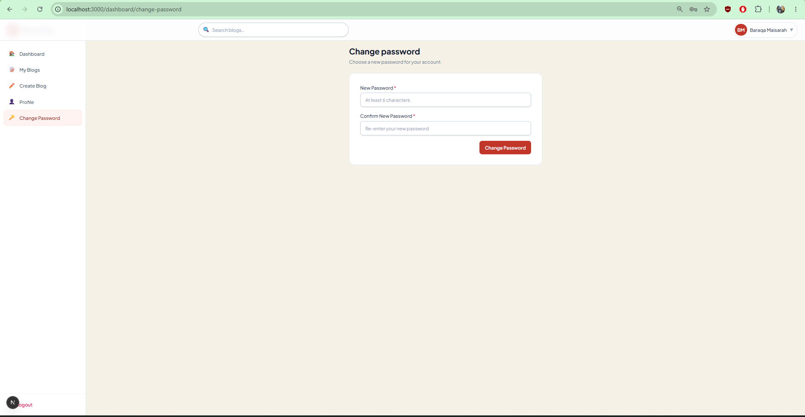 |

### Admin

| Page | Screenshot |
| --- | --- |
| Dashboard | 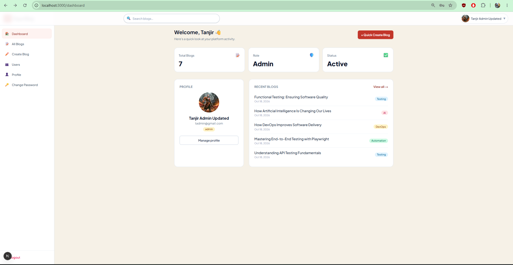 |
| User menu dropdown | 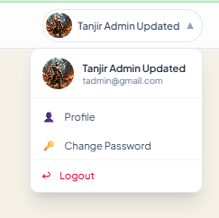 |
| User management | 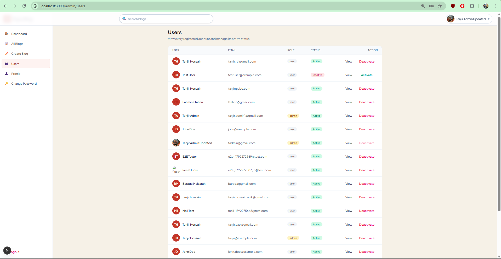 |
| User details | 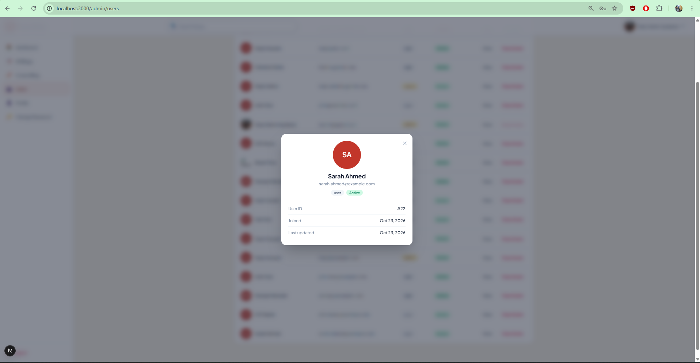 |
| User status toaster | 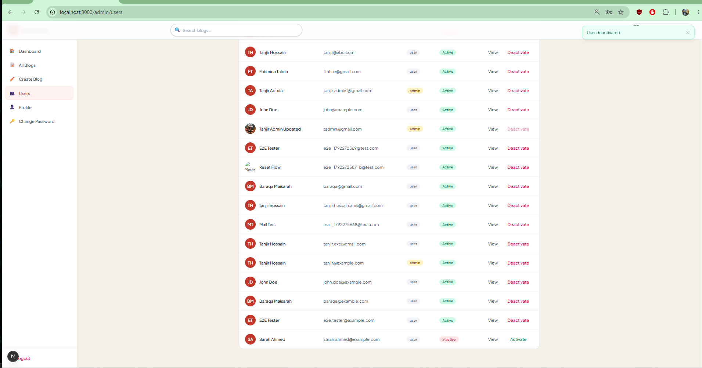 |
| Blog management | 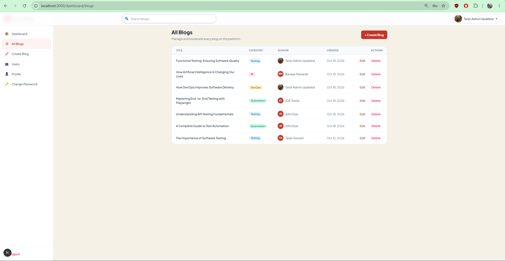 |
| Blog details | 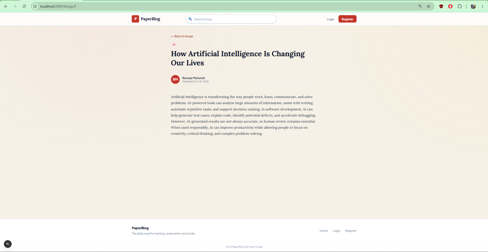 |
| Create blog | 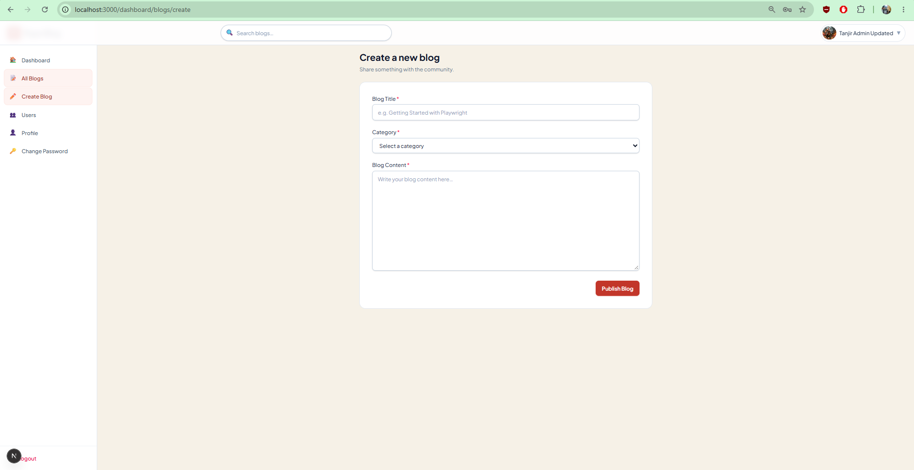 |
| Edit blog | 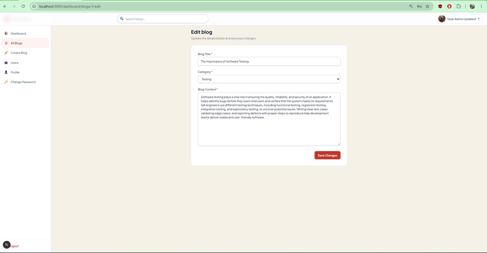 |
| Delete blog confirmation | 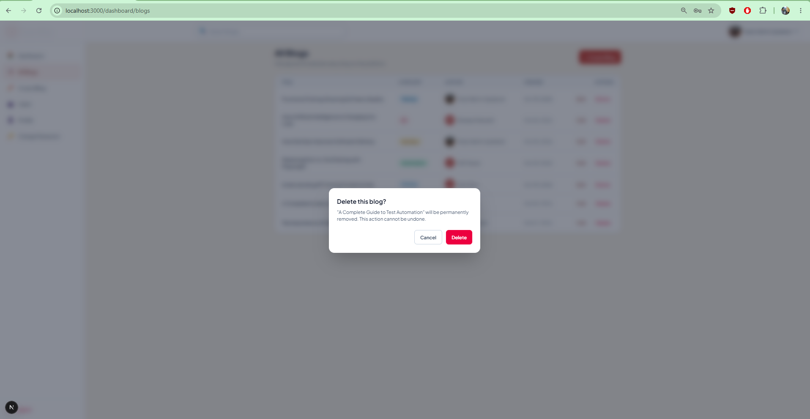 |
| Profile | 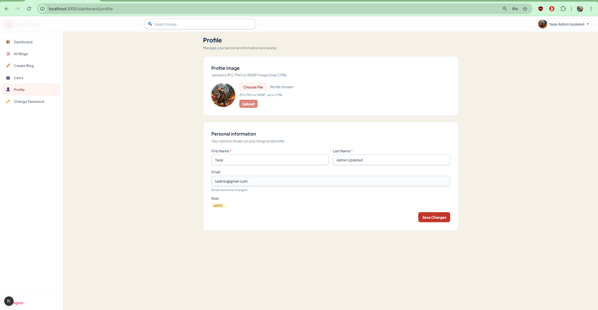 |
| Change password | 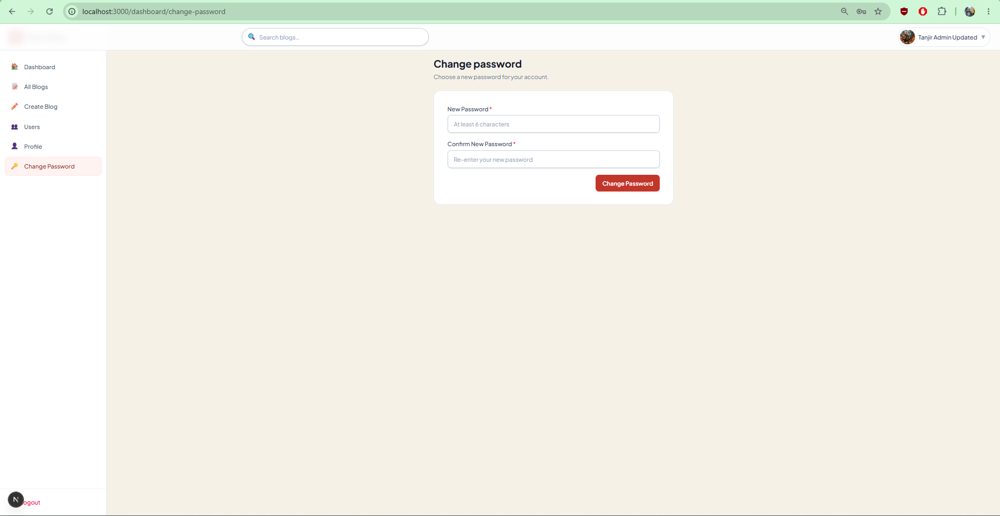 |
